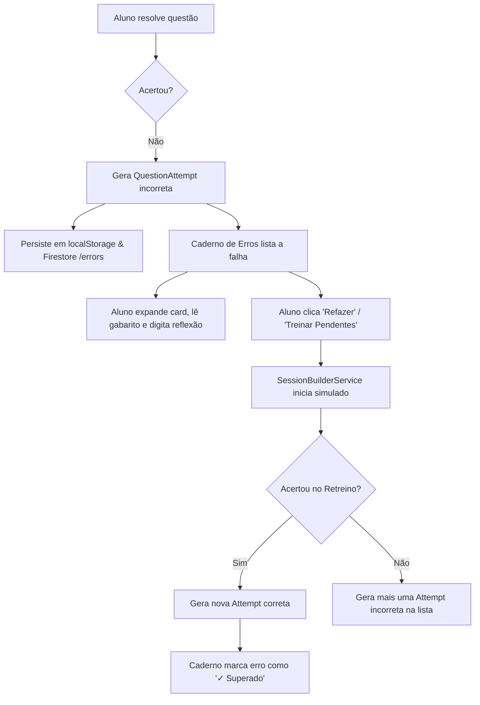
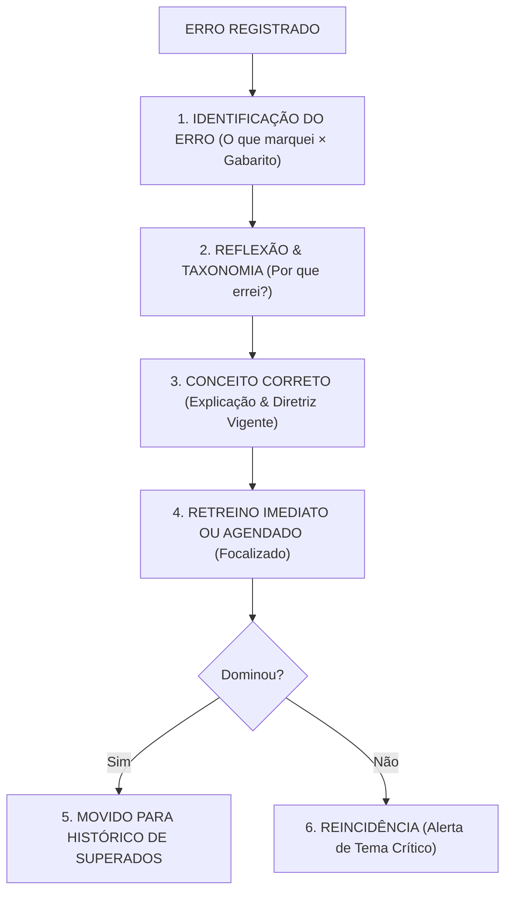

# ERROR_NOTEBOOK_PEDAGOGICAL_FLOW_AUDIT.md
# Relatório de Auditoria de Fluxo Pedagógico e Arquitetura do Caderno de Erros
**Etapa:** 1.21A — Auditoria do Ciclo Pedagógico do Caderno de Erros  
**Componente Principal:** `src/components/errors/ErrorNotebookView.tsx`  
**Data:** 03 de Setembro de 2026  
**Status:** `ERROR_NOTEBOOK_PEDAGOGICAL_FLOW_AUDITED`  
**Testes:** 258/258 PASS (35 suítes de teste, 0 erros no console)  

---

## 1. ÁRVORE DE COMPONENTES E INTERAÇÕES

```
ErrorNotebookView (src/components/errors/ErrorNotebookView.tsx)
├── Header Compacto (Título, contagem total de erros, botão "TREINAR X ERROS PENDENTES")
├── Summary Cards (3 KPIs: Para Revisar, Temas Recorrentes, Questões Superadas)
├── Filter & Search Bar
│   ├── Status Filter Tabs (Todos, Para Revisar, Superados)
│   ├── Search Input (Busca por tema, subtema, caso clínico, código)
│   └── Area Filter Chips (Todas, CM, CG, PED, GO, PREV/SUS)
└── Error Items List / Empty State
    └── Error Item Card (para cada tentativa incorreta)
        ├── Card Header (Código, Área temática, Badge de recorrência, Badge "Superado", Resposta marcada vs Gabarito)
        └── Card Expanded Details (Accordion)
            ├── Caso Clínico Integral
            ├── Resposta do Candidato vs Gabarito Oficial INEP
            ├── Comentário Editorial StaziaMed
            ├── Reflexão Pessoal ("Por que eu errei esta questão?") + Botão Salvar
            └── Footer: Data de registro + Botão "Refazer Esta Questão"
```

---

## 2. SOURCE OF TRUTH & PERSISTÊNCIA

- **ERROR_ATTEMPT_SOURCE:** `AppContext.attempts` / `StorageService` (chave `praxis_attempts_v2`).
- **ERROR_REFLECTION_SOURCE:** `AppContext.reflectionTexts` (estado local) + `ErrorAutopsyDoc.userReflection` (Firestore `/errors` / `AppContext.errorAutopsies`).
- **ERROR_FIRESTORE_PURPOSE:** Persistência em nuvem assíncrona da coleção `/errors/{errorId}` gerada em `FirebaseService.recordErrorAutopsy()` quando o usuário autenticado erra uma questão.
- **ERROR_AUTHORITATIVE_SOURCE:** `localStorage.praxis_attempts_v2` (Local / Offline First) com espelhamento no Firestore.

---

## 3. CRITÉRIOS DE ENTRADA NO CADERNO (`ERROR_ENTRY_CRITERIA`)

- **Regra de Entrada:** `!attempt.isCorrect` (todas as tentativas onde o usuário errou a alternativa).
- **Não entram:** Respostas corretas, questões não respondidas (abandonadas antes de submeter).
- **Respostas em branco:** Se submetidas com opção vazia/inválida e marcadas como `isCorrect: false`, entram no array de attempts.

---

## 4. TRATAMENTO DE DUPLICIDADE E ERROS REPETIDOS (`REPEATED_ERROR_HANDLING`)

- **Classificação:** `MULTIPLE_ENTRIES` na listagem visual; `CONSOLIDATED` no retreino.
- **Comportamento:** Se o aluno errar a mesma questão 3 vezes em sessões diferentes, a lista exibe **3 cards independentes** (um para cada tentativa histórica registrada com seu timestamp).
- **No Retreino:** A função `handleTrainErrorQuestions()` consolida os IDs únicos via `Array.from(new Set(itemsToTrain.map(i => i.attempt.questionId)))`, evitando que o aluno responda a mesma questão 3 vezes no mesmo simulado de retreino.

---

## 5. IDENTIDADE DA QUESTÃO (`ERROR_QUESTION_IDENTITY_KEY`)

- **Chave Canônica:** `questionId` (string serial, ex: `q-rev-2024-cm-12`).
- **Deduplicação de Questão:** Mapeamento via `qMap.get(att.questionId)`.

---

## 6. MODELO DE CICLO DE VIDA DO ERRO (`ERROR_LIFECYCLE_MODEL`)

- **Estados no Código Atual:**
  - `PENDING` ("Para Revisar"): Erro registrado sem acerto posterior.
  - `REMEDIATED` ("Superado"): Detectado via `hasLaterCorrectAttempt` (existe tentativa com timestamp posterior e `isCorrect: true`) ou `autopsy.resolutionStatus === "REMEDIATED" | "MASTERED"`.
- **Limitação:** Não há estado formal intermediário como `EM_REVISAO`, `RETREINANDO` ou `ARQUIVADO`.

---

## 7. CRITÉRIOS DE SAÍDA DO CADERNO (`ERROR_EXIT_CRITERIA`)

- **Classificação:** `FILTER_ONLY_EXIT` (Não há deleção do registro).
- **Mecanismo Real:** Quando o aluno acerta a questão posteriormente, o card recebe a flag `isRemediated = true`.
  - Na aba "Para Revisar", o item deixa de aparecer.
  - Na aba "Todos" e "Superados", o registro histórico permanece gravado indefinidamente.
- **ERROR_NOTEBOOK_ACCUMULATION_RISK:** `HIGH` (Sem mecanismo de expurgo ou arquivamento de longo prazo, a lista total cresce continuamente).

---

## 8. REFLEXÃO DO ALUNO (`ERROR_REFLECTION`)

- **Classificação:** `FUNCTIONAL`
- **Interface:** Campo de texto livre (*textarea*) dentro do accordion expandido de cada card de erro.
- **Persistência:** Salva localmente em `reflectionTexts[attempt.id]` e despacha chamada para `updateErrorAutopsyReflection()` no Firestore.

---

## 9. TAXONOMIA DE CAUSA DE ERRO (`ErrorTaxonomy`)

Existem 8 categorias canônicas definidas no enum `ErrorTaxonomy`:
1. `DISTRACTOR_TRAP`: Pegadinha / Distrator
2. `KNOWLEDGE_GAP`: Lacuna Teórica
3. `DIAGNOSIS_VS_CONDUCT`: Diagnóstico vs Conduta
4. `READING_HASTE`: Desatenção / Leitura Rápida
5. `PROTOCOL_CONFUSION`: Protocolo SUS
6. `ELIMINATED_RIGHT_ANSWER`: Trocou a Certa
7. `TIME_PRESSURE`: Pressão de Tempo
8. `OUTDATED_GUIDELINE`: Diretriz Antiga

*Nota:* A seleção dessas categorias é feita no feedback pós-questão (`LayeredCorrectionFeedback`), enquanto no `ErrorNotebookView` a reflexão é em texto livre.

---

## 10. AUTÓPSIA DO ERRO & INTEGRAÇÃO COM IA (`ERROR_AUTOPSY`)

- **Classificação:** `FUNCTIONAL` (Multicamadas).
- **ERROR_AUTOPSY_AI_USED:** `YES`
- **Funcionamento:** Em `LayeredCorrectionFeedback`, o modo `"autopsy"` aciona `AiService.askTutor()`, que injeta a memória cognitiva do aluno e solicita uma análise socrática focada na armadilha do distrator.
- **REFLECTION_AUTOPSY_OVERLAP:** `HIGH` (A autópsia automática da IA e a reflexão manual do aluno convivem em momentos distintos da jornada).

---

## 11. FLUXO DE RETREINO (`ERROR_RETRAIN_FLOW`)

- **Classificação:** `CENTRAL_QUESTION_ENGINE`
- **Funcionamento:** O botão `"TREINAR ERROS PENDENTES"` e o botão `"Refazer Esta Questão"` configuram uma sessão através de `SessionBuilderService.saveActiveSession()`, definem o modo como `EXAM` e redirecionam o aluno para a rota `praticar-questoes`.
- **Seleção:**
  - Treino Geral: Envia todas as questões filtradas na tela atual.
  - Treino Unitário: Envia exclusivamente a questão do card clicado.

---

## 12. IMPACTO DO RETREINO NO ESTADO DO ERRO (`RETRAIN_RESULT_UPDATES_ERROR_STATE`)

- **Classificação:** `YES`
- **Mecanismo:** Ao acertar a questão no simulador central de questões, uma nova `QuestionAttempt` com `isCorrect: true` e timestamp atual é registrada em `attempts`. Na próxima renderização do Caderno de Erros, a condição `hasLaterCorrectAttempt` é avaliada como verdadeira, atualizando o status para "Superado" e decrementando o contador de pendências.

---

## 13. DETECÇÃO DE ERROS RECURRENTES (`RECURRENT_ERROR_DETECTION`)

- **Classificação:** `TOPIC_LEVEL`
- **Funcionamento:** O mapa `recurrentTopicsMap` agrupa erros por `q.topic`. Se $\ge 2$ erros pertencerem ao mesmo tema, o card ganha o selo `⚠️ X erros neste tema` e o KPI superior contabiliza o tema como recorrente.

---

## 14. VÍNCULO COM TÓPICO CANÔNICO (`ERROR_CANONICAL_TOPIC_LINK`)

- **Classificação:** `PARTIAL`
- **Diagnóstico:** Os erros usam `q.topic` e `q.subtopic` (strings), mas não possuem link dinâmico direto para o `canonicalTopicId` de `GrandesTemasView`.

---

## 15. FILTROS, ORDENAÇÃO E DENSIDADE VISUAL

- **Filtros Disponíveis:**
  - Status: Todos, Para Revisar, Superados.
  - Grande Área: Todas, Clínica Médica, Cirurgia Geral, Pediatria, G&O, Preventiva/SUS.
  - Busca Textual: Tema, subtema, código e enunciado.
- **Ordenação:** Cronológica decrescente fixa (`mais recente primeiro`).
- **Métricas Visíveis no Topo:** 3 KPIs (Para Revisar, Temas Recorrentes, Questões Superadas).
- **ERROR_FIRST_VIEWPORT_ELEMENTS:** ~13 elementos interativos.
- **ERROR_NOTEBOOK_DENSITY:** `MEDIUM`
- **PERFORMANCE_OVERLAP:** `LOW` (Foco estrito em contagem de erros e remediação, sem duplicar gráficos globais de acurácia).

---

## 16. INTEGRAÇÃO COM PLANO DE ESTUDO (HOJE & SEMANAL)

- **ERROR_TODAY_PLAN_INTEGRATION:** `PARTIAL` (Blocos de 30/60/120 min do `AdaptiveEngine` prescrevem tarefas do tipo `ERROR_AUTOPSY`).
- **ERROR_WEEKLY_PLAN_INTEGRATION:** `PARTIAL` (`WeeklyBulletinModal` sumariza as falhas mais frequentes e recomenda revisão).

---

## 17. COMPARATIVO DE RESPOSTA E SCANABILITY

- **ANSWER_COMPARISON_CLARITY:** `HIGH` (O card fechado já mostra "Marcou B | Gabarito: C"; ao expandir, exibe blocos contrastantes coloridos com a justificativa oficial).
- **Enunciado:** Resumido em 1 linha no card fechado; integralmente expansível no clique.
- **ERROR_TO_FLASHCARD_FLOW:** `AUTOMATIC_ON_ATTEMPT` (Gera flashcard no ato do erro pelo `AppContext`, mas sem botão manual de exportação na listagem do Caderno).

---

## 18. FLUXOGRAMAS COMPARATIVOS

### Fluxo Atual:


### Fluxo Ideal Recomendado para Próxima Etapa:


---

## 19. RESUMO EXECUTIVO DE MÉTRICAS OBRIGATÓRIAS

```yaml
1. ERROR_NOTEBOOK_PRIMARY_PURPOSE: ACTIVE_REMEDIATION
2. ERROR_ATTEMPT_SOURCE: AppContext.attempts / StorageService (praxis_attempts_v2)
3. ERROR_REFLECTION_SOURCE: AppContext.reflectionTexts / Firestore /errors
4. ERROR_FIRESTORE_PURPOSE: Remote error autopsy synchronization (/errors collection)
5. ERROR_AUTHORITATIVE_SOURCE: localStorage praxis_attempts_v2
6. ERROR_ENTRY_CRITERIA: !attempt.isCorrect
7. REPEATED_ERROR_HANDLING: MULTIPLE_ENTRIES (List) / CONSOLIDATED (Retrain)
8. ERROR_QUESTION_IDENTITY_KEY: questionId
9. ERROR_LIFECYCLE_MODEL: PENDING -> REMEDIATED (Derived from timestamped attempts)
10. ERROR_EXIT_CRITERIA: hasLaterCorrectAttempt (Filtered out from Pending tab)
11. ERROR_NOTEBOOK_ACCUMULATION_RISK: HIGH (Historical errors accumulate without archival)
12. ERROR_REFLECTION: FUNCTIONAL (Free text textarea + Firestore sync)
13. ERROR_AUTOPSY: FUNCTIONAL (AI Tutor mode + LayeredCorrectionFeedback)
14. ERROR_AUTOPSY_AI_USED: YES (Gemini/Claude via AiService.askTutor)
15. REFLECTION_AUTOPSY_OVERLAP: HIGH
16. ERROR_RETRAIN_FLOW: CENTRAL_QUESTION_ENGINE (SessionBuilderService -> praticar-questoes)
17. RETRAIN_RESULT_UPDATES_ERROR_STATE: YES (Timestamp comparison with latest attempt)
18. RECURRENT_ERROR_DETECTION: TOPIC_LEVEL (Counts >= 2 per topic)
19. ERROR_CANONICAL_TOPIC_LINK: PARTIAL (Uses topic string, not canonicalTopicId)
20. ERROR_NOTEBOOK_VISIBLE_METRICS: 3 (Para Revisar, Temas Recorrentes, Questões Superadas)
21. PERFORMANCE_OVERLAP: LOW
22. ERROR_ITEM_VISIBLE_DATA_POINTS: 8 (Code, Area, Topic, Case snippet, Selected, Answer, Recurrence, Status)
23. ANSWER_COMPARISON_CLARITY: HIGH
24. ERROR_TODAY_PLAN_INTEGRATION: PARTIAL (AdaptiveEngine ERROR_AUTOPSY blocks)
25. ERROR_WEEKLY_PLAN_INTEGRATION: PARTIAL (WeeklyBulletinModal error autopsy diagnostic)
26. ERROR_NOTEBOOK_DENSITY: MEDIUM
27. ERROR_FIRST_VIEWPORT_ELEMENTS: 13
28. ERROR_NEXT_ACTION_CLEAR: YES (CTA "TREINAR X ERROS PENDENTES")
29. ACTIVE_REMEDIATION_MODEL_SUPPORTED: YES
30. ACTIVE_HISTORY_SEPARATION_SUPPORTED: YES
31. TEST_SUITE_BASELINE: 258/258 PASS
32. FINAL_CLASSIFICATION: ERROR_NOTEBOOK_PEDAGOGICAL_FLOW_AUDITED
```

---

## 20. CONCLUSÃO

O Caderno de Erros do StaziaMed possui um ciclo funcional de remediação ativa bem articulado com o motor central de questões (`SessionBuilderService`), atualização de status pós-acerto e suporte à reflexão. As principais oportunidades de refinamento futuro concentram-se na separação visual entre *Erros Ativos* e *Histórico de Erros*, e na unificação das taxonomias de erro.

**Classificação:** `ERROR_NOTEBOOK_PEDAGOGICAL_FLOW_AUDITED`
