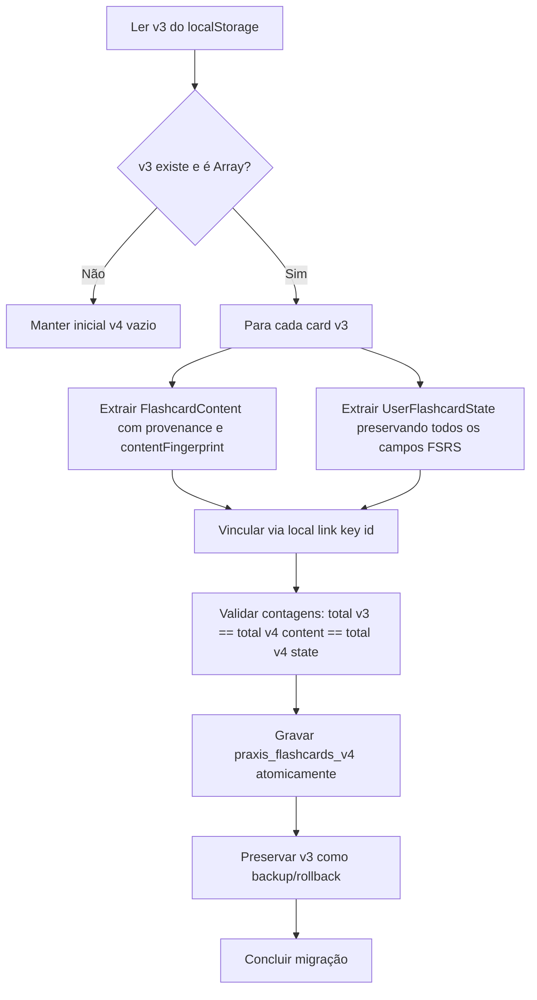

# Relatório de Auditoria e Design Arquitetural: Separação Content / State dos Flashcards (Etapa 1.22D)

## 1. Objetivo e Escopo da Auditoria

O objetivo desta etapa (*Read-Only*) é conceber e detalhar formalmente a arquitetura necessária para desacoplar o **Conteúdo Pedagógico** (`FlashcardContent`) do **Estado de Memória do Estudante** (`UserFlashcardState`) no StaziaMed Revalida, preparando uma migração futura $v3 \to v4$ segura, determinística, idempotente e livre de perdas do algoritmo FSRS.

---

## 2. Auditoria Campo por Campo do Modelo Atual (`Flashcard`)

Atualmente, o tipo `Flashcard` agrega 26 propriedades em um único objeto monolítico. A classificação rigorosa de cada campo é apresentada a seguir:

| Campo | Tipo Atual | Classificação | Racional Arquitetural |
| :--- | :--- | :--- | :--- |
| `id` | `string` | **RUNTIME_ONLY / LOCAL_BRIDGE** | ID da instância do cartão no cliente (`TIMESTAMP_PLUS_RANDOM`). Atua como chave de ligação local durante a transição. |
| `questionId` | `string?` | **LEGACY / PROVENANCE** | Ponteiro legado para a questão de origem. Substituído/enriquecido por `provenance.sourceQuestionId`. |
| `canonicalTopicId` | `string?` | **CONTENT** | Identificador taxonômico estável do tema médico INEP. Pertence ao catálogo de conteúdo. |
| `area` | `MedicalArea` | **CONTENT** | Grande Área médica canônica (ex: `CLINICA_MEDICA`). Pertence ao conteúdo. |
| `topic` | `string` | **CONTENT** | Tema clínico de estudo (ex: `Cardiologia`). Pertence ao conteúdo. |
| `front` | `string` | **CONTENT** | Gatilho / pergunta clínica do cartão. Conteúdo compartilhado. |
| `back` | `string` | **CONTENT** | Resposta / conduta padrão-ouro no SUS. Conteúdo compartilhado. |
| `keyMnemonic` | `string?` | **CONTENT** | Mnemônico ou dica contextual brasileira. Conteúdo compartilhado. |
| `provenance` | `FlashcardProvenance?` | **PROVENANCE** | Metadados factuais de origem (`QUESTION_DERIVED`, `AI_GENERATED`, etc.). Pertence ao conteúdo. |
| `contentFingerprint` | `string?` | **CONTENT** | Hash determinístico versionado do texto normalizado (`fc_fp_v1_<hash>`). |
| `contentFingerprintVersion` | `number?` | **CONTENT** | Versão do algoritmo de fingerprinting (atualmente `1`). |
| `contentVersion` | `number?` | **CONTENT** | Versão editorial do conteúdo médico (atualmente `1`). |
| `schedulerVersion` | `"FSRS_V1" \| "LEGACY_V1"?` | **USER_STATE** | Versão do agendador FSRS aplicada ao aprendizado do usuário. |
| `stability` | `number?` | **USER_STATE** | $S$: Estabilidade de memória FSRS em dias para este estudante. |
| `difficulty` | `number?` | **USER_STATE** | $D$: Nível de dificuldade FSRS (escala 1-10) percebido pelo estudante. |
| `elapsedDays` | `number?` | **USER_STATE** | Dias decorridos desde a última revisão do estudante. |
| `scheduledDays` | `number?` | **USER_STATE** | Intervalo em dias calculado para a próxima revisão do estudante. |
| `reps` | `number?` | **USER_STATE** | Contagem total de repetições realizadas pelo estudante. |
| `lapses` | `number?` | **USER_STATE** | Contagem total de esquecimentos (*Again*) sofridos pelo estudante. |
| `state` | `number?` | **USER_STATE** | Estado FSRS (0=New, 1=Learning, 2=Review, 3=Relearning). |
| `lastReviewed` | `string?` | **USER_STATE** | Timestamp ISO da última revisão feita pelo estudante. |
| `dueDate` | `string` | **USER_STATE** | Data/hora ISO em que o cartão fica devido para o estudante. |
| `intervalDays` | `number` | **LEGACY / USER_STATE** | Campo de retrocompatibilidade SM-2 (dias de intervalo). |
| `easeFactor` | `number` | **LEGACY / USER_STATE** | Campo de retrocompatibilidade SM-2 (fator de facilidade). |
| `repetitionCount` | `number` | **LEGACY / USER_STATE** | Alias legado para `reps`. |
| `masteryLevel` | `number` | **AMBIGUOUS / USER_STATE** | Indicador derivado de domínio (0-100%) calculado a partir de $S$ e $lapses$. |

---

## 3. Modelos Futuros Desacoplados

### 3.1 Modelo de Conteúdo (`FlashcardContent`)
```ts
export interface FlashcardContent {
  contentId: string;                     // ID canônico do conteúdo
  front: string;                         // Enunciado / Gatilho
  back: string;                          // Conduta / Explicação
  keyMnemonic?: string;                  // Mnemônico / Nota SUS
  canonicalTopicId?: string;             // Taxonomia INEP
  area: MedicalArea;                     // Grande Área
  topic: string;                         // Tema
  provenance: FlashcardProvenance;       // Origem factual
  contentFingerprint: string;            // fc_fp_v1_<hash>
  contentFingerprintVersion: number;     // 1
  contentVersion: number;                // 1
  contentReviewStatus?: FlashcardContentReviewStatus;
  createdAt: string;                     // ISO
  updatedAt?: string;                    // ISO
}
```

### 3.2 Modelo de Estado do Usuário (`UserFlashcardState`)
```ts
export interface UserFlashcardState {
  flashcardId: string;                   // Chave de ligação ao FlashcardContent
  userId: string;                        // UID do estudante ou guestId
  schedulerVersion: "FSRS_V1";
  stability: number;                     // FSRS S
  difficulty: number;                    // FSRS D
  elapsedDays: number;
  scheduledDays: number;
  reps: number;
  lapses: number;
  state: number;
  lastReviewed?: string;                 // ISO
  dueDate: string;                       // ISO
  createdAt: string;                     // ISO
  updatedAt?: string;                    // ISO
}
```

---

## 4. Invariantes de Isolamento e Não-Compartilhamento de Estado

- **Regra Fundamental:** Parâmetros de memória (`dueDate`, `stability`, `difficulty`, `state`, `reps`, `lapses`, `lastReviewed`) pertencem **exclusivamente** ao estudante (`UserFlashcardState`).
- **Conteúdo Compartilhável:** `front`, `back`, `keyMnemonic`, `canonicalTopicId`, `area`, `provenance`, `contentVersion` e `contentReviewStatus` representam conhecimento médico universal e podem ser compartilhados entre todos os estudantes.

---

## 5. Estratégia de Identidade e Identificadores

1. **Papel do ID Atual (`flashcard.id`):**
   - O identificador atual `fc-<timestamp>-<random>` atua como `LOCAL_BRIDGE_ID` durante a fase local transitória.
   - **Não promover a ID canônico global:** Um ID gerado aleatoriamente no cliente não deve ser tratado como autoridade canônica mestre de conteúdo.
2. **Estratégia para `contentId`:**
   - Classificação: `DETERMINISTIC_SOURCE_ID_OR_HYBRID`.
   - Para cartões derivados de questões oficiais: Pode-se compor um ID determinístico baseado em `${sourceCanonicalQuestionId || sourceQuestionId}_${purposeTag}_v${contentVersion}` (ex: `REV-2024.1-CM-01_autopsy_v1`).
   - Para cartões gerados por IA ou manuais: Identificador atribuído pelo servidor / pipeline editorial.
3. **Papel do `contentFingerprint`:**
   - O fingerprint `fc_fp_v1_<hash>` serve para matching, detecção de duplicatas e migração resiliente, **nunca** como chave primária autoritativa ou foreign key exclusiva.
4. **Múltiplos Cartões por Questão:**
   - Uma única questão clínica pode gerar múltiplos cartões (ex: Diagnóstico, Conduta Imediata, Investigação Suplementar, Contraindicação). Portanto, `sourceQuestionId` isolado **não** é suficiente para identificar o conteúdo.

---

## 6. Persistência Local: Análise de Riscos e Recomendação para `v4`

### 6.1 Análise de Atomicidade em `localStorage`
- `localStorage` do navegador não possui suporte a transações ACID (`MULTI_KEY_ATOMICITY_RISK = HIGH`).
- Se utilizássemos duas chaves separadas (`praxis_flashcard_contents_v4` e `praxis_flashcard_states_v4`), falhas de cota (`QuotaExceededError`), fechamento de aba ou exceções entre o primeiro e o segundo `setItem` gerariam estados órfãos e corrupção silenciosa.

### 6.2 Recomendação de Persistência (`V4_LOCAL_STORAGE_RECOMMENDATION`)
- **Recomendação:** `SINGLE_ENVELOPE` sob a chave com namespace do usuário:
  `praxis_flashcards_v4:user:${uid}` e `praxis_flashcards_v4:guest:${guestId}`.
- **Formato Recomendado:**
  ```json
  {
    "schemaVersion": 4,
    "updatedAt": "2026-09-03T22:20:00.000Z",
    "contents": {
      "fc_content_1": { /* FlashcardContent */ }
    },
    "userStates": {
      "fc_content_1": { /* UserFlashcardState */ }
    }
  }
  ```
- **Vantagens:** 
  - Gravação 100% atômica em um único `setItem`.
  - Lookups e updates em tempo constante $O(1)$ por chave (`Record<string, ...>`).
  - Modelos desacoplados no código TypeScript e serialização protegida no storage.

---

## 7. Políticas de Órfãos e Resiliência

1. **`ORPHAN_STATE_POLICY` (`QUARANTINE`):**
   - Se existir um `UserFlashcardState` sem `FlashcardContent` correspondente, o estado é colocado em quarentena técnica e não é apresentado na UI de revisão (evitando telas em branco), mas seus parâmetros FSRS são preservados até que o conteúdo seja reidratado ou recuperado.
2. **`ORPHAN_CONTENT_POLICY` (`PRESERVE_UNSCHEDULED`):**
   - Se existir um `FlashcardContent` sem `UserFlashcardState`, ele é tratado como conteúdo de catálogo ainda não agendado pelo usuário (card novo aguardando primeira visualização).

---

## 8. Algoritmo de Migração $v3 \to v4$

O processo de migração deve ser estritamente determinístico, não-destrutivo e idempotente:



### Invariantes do FSRS durante a Migração:
- **`FSRS_STATE_RECOMPUTE_REQUIRED = NO`**: Nenhuma chamada ao motor FSRS ou alteração matemática de $S$, $D$, $R$ ou `dueDate` é permitida durante a migração. A migração é puramente de formato estrutural.

---

## 9. Mapeamento de Consumidores e Padrão Adapter

### 9.1 Consumidores Diretos Identificados (`FLASHCARD_DIRECT_CONSUMER_COUNT = 11`)
1. `PlanoDeHojeView.tsx` (cálculo de devidos do dia)
2. `AdaptiveCalendarView.tsx` (carga futura agrupada por data)
3. `RecoveryPlanModal.tsx` (cartões em atraso para reposição)
4. `WeeklyPlanView.tsx` (distribuição semanal de revisões)
5. `SpacedReviewView.tsx` (sessão ativa de repetição espaçada e rating)
6. `UnifiedReviewView.tsx` (contadores do hub de revisão)
7. `DashboardView.tsx` (widget de revisões pendentes)
8. `ProfileSettingsView.tsx` (contadores e reset de dados)
9. `FunctionCallingAgentView.tsx` (ferramentas do agente IA)
10. `functionCallingService.ts` (execução de tools de flashcards)
11. `AppContext.tsx` (gerenciamento central de estado e progresso)

### 9.2 Recomendação de Compatibility Adapter (`COMPATIBILITY_ADAPTER_RECOMMENDED = YES`)
- Na introdução da $v4$, recomenda-se a criação temporária da função pura `hydrateFlashcardItem(content: FlashcardContent, state: UserFlashcardState): FlashcardReviewItem` em nível de View Model para permitir a transição progressiva das views sem necessidade de refatorar todas as 11 telas simultaneamente em um único commit.

---

## 10. Governança Terminológica e Revisão Editorial

- **`AUTO_VALIDATED`:** Significa estritamente que o conteúdo passou por validação automatizada de esquema, integridade sintática e testes estruturais da pipeline de ingestão. **`AUTO_VALIDATED_MEANS_MEDICAL_VALIDATION = NO`**.
- **`MEDICAL_REVIEWED`:** Indica revisão clínica explícita realizada por médico especialista responsável identificado.
- **`APPROVED`:** Grau de clareza semântica atual classificado como **`MEDIUM`** (necessita no futuro explicitar o escopo: aprovação para catálogo público vs. uso interno de teste).

---

## 11. Visão de Futuro: Preparação para Firestore e Cross-Device Sync

1. **Topologia Firestore Planejada:**
   - `/flashcardContents/{contentId}`: Catálogo global compartilhado de conteúdos médicos.
   - `/users/{uid}/flashcardStates/{contentId}`: Subcoleção privada de progresso e estado FSRS do aluno.
2. **Sincronização Cross-Device:**
   - Sincroniza apenas o estado FSRS do usuário (`UserFlashcardState`), enquanto os conteúdos mestres são cacheados e versionados via `contentVersion`.

---

## 12. Resumo Obrigatório de Métricas e Estados

```
FLASHCARD_CURRENT_FIELD_COUNT = 26

FLASHCARD_CONTENT_FIELDS = [canonicalTopicId, area, topic, front, back, keyMnemonic, contentFingerprint, contentFingerprintVersion, contentVersion]
FLASHCARD_USER_STATE_FIELDS = [schedulerVersion, stability, difficulty, elapsedDays, scheduledDays, reps, lapses, state, lastReviewed, dueDate, intervalDays, easeFactor, repetitionCount]
FLASHCARD_PROVENANCE_FIELDS = [provenance, questionId]
FLASHCARD_AMBIGUOUS_FIELDS = [masteryLevel, id]

CURRENT_FLASHCARD_ID_MIGRATION_ROLE = LOCAL_BRIDGE_ID

FUTURE_CONTENT_ID_STRATEGY = DETERMINISTIC_SOURCE_ID_OR_HYBRID

V3_STORAGE_SHAPE = JSON_ARRAY_OF_MONOLITHIC_FLASHCARDS

MULTI_KEY_ATOMICITY_RISK = HIGH

V4_LOCAL_STORAGE_RECOMMENDATION = SINGLE_ENVELOPE

V4_RECOMMENDED_SHAPE = RECORD_MAPS_WITHIN_SINGLE_ENVELOPE

LOCAL_CONTENT_STATE_LINK_KEY = contentId_or_localBridgeId

ORPHAN_STATE_POLICY = QUARANTINE
ORPHAN_CONTENT_POLICY = PRESERVE_UNSCHEDULED

MIGRATION_IDEMPOTENT_DESIGN = YES

FSRS_STATE_RECOMPUTE_REQUIRED = NO

FLASHCARD_REVIEW_HISTORY_MODEL = DERIVED_FROM_FSRS_STATE_AND_ATTEMPTS

FLASHCARD_DIRECT_CONSUMER_COUNT = 11

COMPATIBILITY_ADAPTER_RECOMMENDED = YES

AUTO_VALIDATED_MEANS_MEDICAL_VALIDATION = NO

APPROVED_STATUS_SEMANTIC_CLARITY = MEDIUM

FUTURE_FIRESTORE_CONTENT_STATE_SPLIT_COMPATIBLE = YES

ACCOUNT_ISOLATION_PRESERVED_BY_DESIGN = YES

CROSS_DEVICE_SYNC_IMPLEMENTED = NO
```

---

## 13. Classificação Final

```
FLASHCARD_CONTENT_STATE_SPLIT_DESIGN_READY
```
