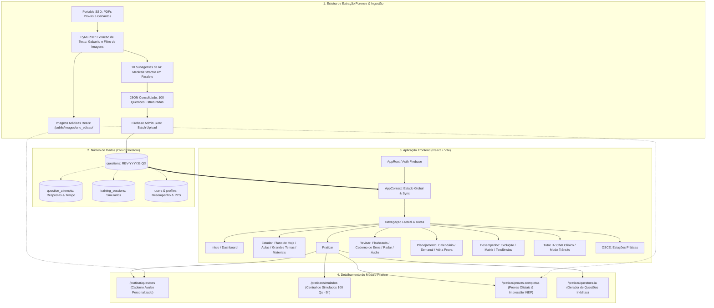

# 📐 StaziaMed Revalida — Organograma e Arquitetura Completa do Sistema

Este documento descreve a arquitetura de ponta a ponta da plataforma **StaziaMed Revalida**, detalhando o fluxo de extração forense com IA, o modelo de dados no Firebase Firestore, as rotas e componentes do Frontend React/Vite.

---

## 🗺️ 1. Organograma Visual (Mermaid)



---

## 📊 2. Organograma Estrutural (Diagrama em Bloco)

```text
========================================================================================================================
                                       STAZIAMED REVALIDA — ORGANOGRAMA COMPLETO
========================================================================================================================

                                         ┌───────────────────────────────────┐
                                         │       PORTABLE SSD (ORIGEM)       │
                                         │  /Volumes/PortableSSD/Provas.../  │
                                         └─────────────────┬─────────────────┘
                                                           │
                                                           ▼
                                         ┌───────────────────────────────────┐
                                         │    ESTEIRA DE EXTRAÇÃO FORENSE    │
                                         │   (Antigravity Engine + Python)   │
                                         └─────────────────┬─────────────────┘
                                                           │
                        ┌──────────────────────────────────┴──────────────────────────────────┐
                        ▼                                                                     ▼
        ┌───────────────────────────────┐                                     ┌───────────────────────────────┐
        │        PyMuPDF (fitz)         │                                     │     10 SUBAGENTES DE IA       │
        │ ── Texto Bruto                │                                     │     (MedicalExtractor)        │
        │ ── Gabarito Decodificado      │                                     │ ── Resolução clínica e itens  │
        │ ── Filtro de Imagens Reais    │                                     │ ── Classificação por temas    │
        │    (Descarta logos/banners)   │                                     │ ── Justificativas A, B, C e D │
        └───────────────┬───────────────┘                                     └───────────────┬───────────────┘
                        │                                                                     │
                        ▼                                                                     ▼
        ┌───────────────────────────────┐                                     ┌───────────────────────────────┐
        │    IMAGENS CLÍNICAS (LOCAL)   │                                     │     JSON 100% ESTRUTURADO     │
        │   /public/images/{edicao}/    │                                     │      (merge_YYYY_E.json)      │
        └───────────────┬───────────────┘                                     └───────────────┬───────────────┘
                        │                                                                     │
                        │                       ┌─────────────────────────────────────────────┘
                        │                       ▼
                        │       ┌───────────────────────────────┐
                        │       │      FIREBASE ADMIN SDK       │
                        │       │   (Upload e Indexação Batch)  │
                        │       └───────────────┬───────────────┘
                        │                       │
                        ▼                       ▼
========================================================================================================================
                                            NÚCLEO DE BANCO DE DADOS (FIRESTORE)
========================================================================================================================
                                      ┌───────────────────────────────────┐
                                      │       staziamed-revalida-prod     │
                                      └─────────────────┬─────────────────┘
                                                        │
         ┌───────────────────────┬──────────────────────┼──────────────────────┬──────────────────────┐
         ▼                       ▼                      ▼                      ▼                      ▼
┌──────────────────┐    ┌──────────────────┐   ┌──────────────────┐   ┌──────────────────┐   ┌──────────────────┐
│   'questions'    │    │'question_attempts│   │'training_sessions│   │     'users'      │   │ 'flashcards' &   │
│ ── Provas INEP   │    │ ── Respostas     │   │ ── Simulados     │   │ ── Perfil        │   │ 'study_plans'    │
│ ── Qs Inéditas   │    │ ── Tempo gasto   │   │ ── Cronômetro    │   │ ── PPS Score     │   │ ── Cronogramas   │
│ ── Gabaritos/Imgs│    │ ── Acertos/Erros │   │ ── Estado atual  │   │ ── Assinatura    │   │ ── Repetição     │
└──────────────────┘    └──────────────────┘   └──────────────────┘   └──────────────────┘   └──────────────────┘
                                                        │
                                                        ▼
========================================================================================================================
                                            APLICAÇÃO FRONTEND (REACT + VITE)
========================================================================================================================
                                      ┌───────────────────────────────────┐
                                      │           AppRoot / Auth          │
                                      │   (Firebase Auth & Guest Mode)    │
                                      └─────────────────┬─────────────────┘
                                                        │
                                                        ▼
                                      ┌───────────────────────────────────┐
                                      │           AppContext.tsx          │
                                      │ (Estado Global + Sincronização)   │
                                      └─────────────────┬─────────────────┘
                                                        │
                                                        ▼
                                      ┌───────────────────────────────────┐
                                      │         Sidebar Navigation        │
                                      └─────────────────┬─────────────────┘
                                                        │
     ┌──────────────┬──────────────┬──────────────┬─────┴────────┬──────────────┬──────────────┬──────────────┐
     ▼              ▼              ▼              ▼              ▼              ▼              ▼              ▼
┌──────────┐   ┌──────────┐   ┌──────────┐   ┌──────────┐   ┌──────────┐   ┌──────────┐   ┌──────────┐   ┌──────────┐
│  INÍCIO  │   │ ESTUDAR  │   │ PRATICAR │   │ REVISAR  │   │PLANEJAME.│   │DESEMPENHO│   │ TUTOR IA │   │   OSCE   │
└────┬─────┘   └────┬─────┘   └────┬─────┘   └────┬─────┘   └────┬─────┘   └────┬─────┘   └────┬─────┘   └────┬─────┘
     │              │              │              │              │              │              │              │
     │              ├─ Plano Hoje  ├─ Questões    ├─ Flashcards  ├─ Calendário  ├─ Geral       ├─ Conversar   └─ Estações
     │              ├─ Aulas       ├─ Simulados   ├─ Cad. Erros  ├─ Semanal     ├─ Evolução    ├─ Trânsito       Práticas
     │              ├─ Gdes Temas  ├─ Provas Comp.├─ Atualizações├─ Até a Prova ├─ Matriz      └─ Histórico
     │              └─ Materiais   └─ Questões IA ├─ Radar Diret.├─ Disponibil. ├─ Tendências
     │                                            └─ Flash-Áudio └─ Replanejam. └─ Áreas
     │
     ▼
┌──────────────────────────────────────────────────────────────────────────────────────────────────────────────────────┐
│                                       DETALHAMENTO DO MÓDULO PRATICAR                                                │
├──────────────────────────────────────────────────────────────────────────────────────────────────────────────────────┤
│ 1. /praticar/questoes          ──► Caderno Avulso (Filtro por 5 Áreas, Temas, Anos e Modo Estudo com Gabarito)       │
│ 2. /praticar/simulados         ──► Central de Simulados (Simulado Geral INEP 100 Qs · 5h e Mini-Simulado Tiro Rápido)│
│ 3. /praticar/provas-completas  ──► Provas na Íntegra (Resolução Online 1 a 100 ou Impressão A4 INEP c/ Marca D'água) │
│ 4. /praticar/questoes-ia       ──► Gerador de Casos Clínicos Inéditos no Padrão de Cobrança da Banca                │
└──────────────────────────────────────────────────────────────────────────────────────────────────────────────────────┘
```

---

## 🛠️ 3. Especificação das Camadas e Componentes

### 3.1. Esteira de Extração Forense (Backoffice)
* **Motor:** Python + PyMuPDF (`fitz`) para parsing de vetores, renderização de páginas e isolamento de imagens clínicas.
* **Inteligência Artificial:** 10 subagentes paralelos por edição (`MedicalExtractor`), garantindo integridade textual, gabarito oficial e comentários item a item.
* **Filtro Anti-Poluição:** Filtra e elimina automaticamente imagens não-clínicas (logos de cabeçalho, vetores de rodapé, setas de numeração).

### 3.2. Banco de Dados (Cloud Firestore)
* **Coleção `questions`:** Documentos canônicos com chaves determinísticas (`REV-{ANO}.{EDICAO}-Q{NUMERO}`).
* **Coleção `question_attempts`:** Rastreabilidade de cada clique do usuário (tempo de resposta, opção marcada, acerto/erro, contexto da resolução).
* **Coleção `training_sessions`:** Persistência de sessões de estudo ativas, permitindo pausar e retomar simulados em qualquer dispositivo.

### 3.3. Módulos do Usuário (Frontend)
1. **Início (`/`):** Métricas diárias, sequência de estudos, Projected Pass Score (PPS) e atalhos rápidos.
2. **Estudar (`/estudar`):** Cronograma do dia, videoaulas e resumos teóricos por especialidade.
3. **Praticar (`/praticar/*`):**
   * `/praticar/questoes`: Gerador de cadernos avulsos com feedback imediato.
   * `/praticar/simulados`: Simulados cronometrados com nota de corte.
   * `/praticar/provas-completas`: Cadernos oficiais do INEP na ordem original (online ou PDF para impressão com marca d'água de segurança).
   * `/praticar/questoes-ia`: Geração de questões inéditas sob demanda.
4. **Revisar (`/revisar`):** Repetição espaçada com Flashcards, Caderno de Erros automático e Radar de Diretrizes.
5. **Planejamento (`/planejamento`):** Calendário dinâmico de metas até a data da prova oficial.
6. **Desempenho (`/desempenho`):** Gráficos de evolução, matriz de competências e análise de pontos fracos.
7. **Tutor IA (`/tutor-ia`):** Assistente clínico inteligente com suporte a comando de voz (Modo Trânsito).
8. **OSCE (`/osce`):** Simulador interativo para a 2ª etapa prática do Revalida.
